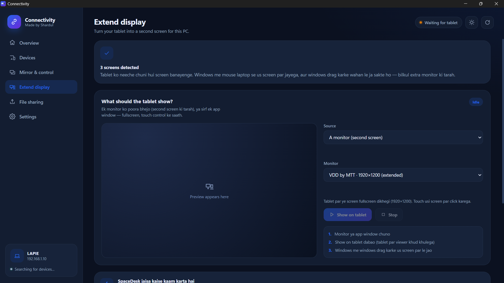

<div align="center">

# 🔗 Connectivity

**Your Android tablet or phone, part of your PC.**

Extend your display, mirror screens both ways, share files and forward mouse & keyboard — all over your own Wi-Fi. No cables. No accounts. No cloud.

[](https://github.com/ShreeMarwadi/SmartConnectClone/releases/latest)
[](https://github.com/ShreeMarwadi/SmartConnectClone/releases/latest)


</div>

---

## ✨ Features

| Feature | What it does |
|---|---|
| 🖥️ **Extend display** | Turn your tablet into a real second monitor. Drag windows from your PC onto it, just like an extra screen. You can also send a single app window instead of the whole monitor. |
| 🪞 **Mirror & control (PC → Tablet)** | See your PC screen on the tablet and control the pointer by touch. |
| 📱 **Reverse mirror (Tablet → PC)** | Show the tablet's screen inside a window on your PC. |
| 📂 **File sharing** | Send files between PC and tablet in a few clicks. Received files land in a folder you choose. |
| ⌨️ **Cross control** | Mouse & keyboard forwarding — touches on the tablet become real mouse and keyboard events on the PC. |
| 📋 **Clipboard sync** | Copy text on one device, paste on the other. |
| 🔒 **Local only** | Everything stays on your local network. No sign-up, no account. |

## 📸 Screenshots

<table>
  <tr>
    <td align="center"><b>Mirror & control</b><br></td>
    <td align="center"><b>Extend display</b><br></td>
  </tr>
</table>

## 🚀 Getting started

### What you need
- A **Windows PC** and an **Android tablet/phone**
- Both devices on the **same Wi-Fi network**

### Install

1. Open the [**Releases**](https://github.com/ShreeMarwadi/SmartConnectClone/releases/latest) page.
2. Download **`Connectivity.lnk`** and run it on your PC.
3. Download **`Connectivity.apk`**, copy it to your tablet/phone and install it. (Android may ask you to allow *Install unknown apps* for your file manager or browser.)
4. Open the app on both devices. The tablet shows up in the PC app automatically within a few seconds.

### Use it

**Extend display**
1. Go to **Extend display** and choose a monitor or an app window.
2. Click **Show on tablet** — the viewer opens on the tablet by itself.
3. Drag windows from your PC onto that screen.

**Mirror**
1. Go to **Mirror & control** and click **Start mirroring** for PC → Tablet.
2. For Tablet → PC, click **Ask tablet to share** and approve the screen-capture permission on the tablet.

**Send files**
- Open **File sharing**, or click **Send a file** on the Overview page.

## ❓ Troubleshooting

- **"Waiting for tablet" never changes** – make sure both devices are on the same Wi-Fi, not a guest network, and that Windows Firewall allows Connectivity on private networks.
- **Extend display shows no extra monitor** – the app uses a virtual display driver; allow it if Windows asks for permission.
- **Android blocks the install** – enable *Install unknown apps* for the app you used to open the `.apk`.
- **Tablet → PC mirroring does nothing** – approve the screen-capture prompt on the tablet.

## 🛠️ Build from source

```bash
git clone https://github.com/ShreeMarwadi/SmartConnectClone.git
cd SmartConnectClone
```

> Ready-made builds are in [Releases](https://github.com/ShreeMarwadi/SmartConnectClone/releases/latest). Build output folders such as `build-portable/` are intentionally not tracked in Git.

## 🤝 Contributing

Bug reports and ideas are welcome — open an [issue](https://github.com/ShreeMarwadi/SmartConnectClone/issues).

## 👤 Author

Made by **Shardul**.

## 📄 License

Add a `LICENSE` file to choose how others may use this project (MIT is a common choice).
