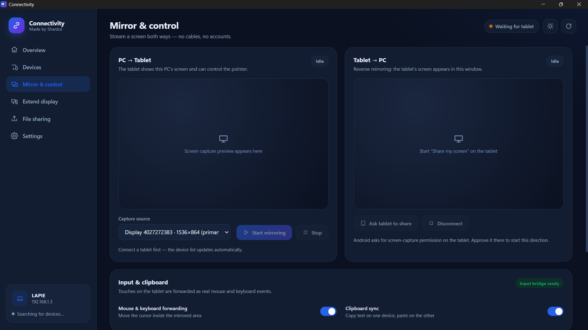

<div align="center">

# 🔗 Connectivity

**Your Android tablet or phone, part of your PC.**

Extend your display, mirror screens both ways, share files and forward mouse & keyboard — all over your own Wi-Fi. No cables. No accounts. No cloud.

[](https://github.com/ShreeMarwadi/Connectivity/releases/latest)
[](https://github.com/ShreeMarwadi/Connectivity/releases/latest)

</div>

---

## ✨ Features

| Feature | What it does |
|---|---|
| 🖥️ **Extend display** | Turn your tablet into a real second monitor. Drag windows from your PC onto it, just like an extra screen. You can also send a single app window instead of the whole monitor. |
| 🪞 **Mirror & control (PC → Tablet)** | See your PC screen on the tablet and control the pointer by touch. |
| 📱 **Reverse mirror (Tablet → PC)** | Show the tablet's screen inside a window on your PC. |
| 🎥 **Facecam (Tablet → PC camera)** | Use your tablet's camera as a real webcam in any Windows app — Discord, Zoom, Teams, OBS, browsers. No extra drivers to install. |
| 📂 **File sharing** | Send files between PC and tablet in a few clicks. Received files land in a folder you choose. |
| ⌨️ **Cross control** | Mouse & keyboard forwarding — touches on the tablet become real mouse and keyboard events on the PC. |
| 📋 **Clipboard sync** | Copy text on one device, paste on the other. |
| 🔒 **Local only** | Everything stays on your local network. No sign-up, no account. |

## 📸 Screenshots

<table>
  <tr>
    <td align="center"><b>Mirror & control</b><br></td>
    <td align="center"><b>Extend display</b><br></td>
  </tr>
</table>

## 🚀 Getting started

### What you need
- A **Windows PC** and an **Android tablet/phone**
- Both devices on the **same Wi-Fi network**

### Install

1. Open the [**Releases**](https://github.com/ShreeMarwadi/Connectivity/releases/latest) page.
2. Download **`Connectivity-Setup-1.0.4.exe`** (installer) or **`Connectivity-Portable-1.0.4.zip`** (no install) and run it on your PC.
3. Download **`Connectivity-1.0.4.apk`**, copy it to your tablet/phone and install it. (Android may ask you to allow *Install unknown apps* for your file manager or browser.)
4. Open the app on both devices. The tablet shows up in the PC app automatically within a few seconds.

> **Upgrading from 1.0.3?** The APK is now signed with a new key, so Android will not update the old app in place. Uninstall the old **Connectivity** app first, then install `Connectivity-1.0.4.apk`.

### Use it

**Extend display**
1. Go to **Extend display** and choose a monitor or an app window.
2. Click **Show on tablet** — the viewer opens on the tablet by itself.
3. Drag windows from your PC onto that screen.

**Mirror**
1. Go to **Mirror & control** and click **Start mirroring** for PC → Tablet.
2. For Tablet → PC, click **Ask tablet to share** and approve the screen-capture permission on the tablet.

**Send files**
- Open **File sharing**, or click **Send a file** on the Overview page.

**Facecam**
1. Open **Facecam** and click **Start camera**.
2. On the tablet, allow the camera permission when asked.
3. In Discord/Zoom/Teams/OBS (or any website), pick **Connectivity Camera** as your camera. The feed appears there and stays alive even if the Facecam window is in the background.
4. Click **Stop** when you are done — the virtual camera returns to a neutral idle card instead of a green screen.

## ❓ Troubleshooting

- **"Waiting for tablet" never changes** – make sure both devices are on the same Wi-Fi, not a guest network, and that Windows Firewall allows Connectivity on private networks.
- **Extend display shows no extra monitor** – the app uses a virtual display driver; allow it if Windows asks for permission.
- **Android blocks the install** – enable *Install unknown apps* for the app you used to open the `.apk`.
- **Tablet → PC mirroring does nothing** – approve the screen-capture prompt on the tablet.
- **Facecam not listed in an app** – close and reopen the app after starting the camera; most apps only scan for cameras at startup. In browsers pick **Connectivity Camera** in the site's camera permission dropdown.
- **Facecam shows a green or black screen** – press **Stop** then **Start camera** again. If it stays green, close other apps that may be using the camera and restart Connectivity.
- **Facecam video is upside down** – fixed in 1.0.4; update both the PC app and the APK.

## 🛠️ Build from source

```bash
git clone https://github.com/ShreeMarwadi/Connectivity.git
cd Connectivity
```

> Ready-made builds are in [Releases](https://github.com/ShreeMarwadi/Connectivity/releases/latest). Build output folders such as `build-portable/` are intentionally not tracked in Git.

Desktop app:

```bash
npm install
npm run dist
```

Android app (needs JDK 17 + Android SDK 34):

1. Copy `android/keystore.properties.example` to `android/keystore.properties` and point it at your own keystore. Without this file `assembleRelease` produces an **unsigned** APK — the real keystore and its passwords are never committed.
2. Run `gradle assembleRelease` inside `android/`.

## 🤝 Contributing

Bug reports and ideas are welcome — open an [issue](https://github.com/ShreeMarwadi/Connectivity/issues).

## 👤 Author

Made by **Shardul**.

## 📄 License

Add a `LICENSE` file to choose how others may use this project (MIT is a common choice).